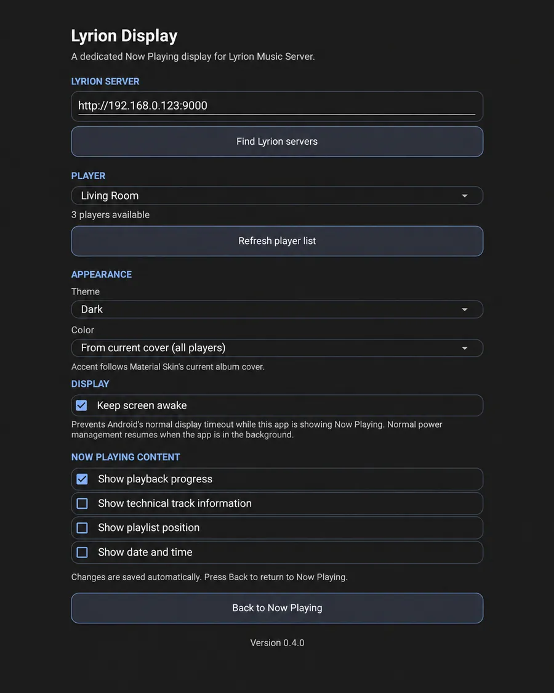

# Lyrion Display

[](artwork/lyrion-display-banner-source.webp)

A lightweight Android app that turns a Fire TV, Android TV, tablet, or other compatible Android-based device into a dedicated, fullscreen **Now Playing display** for [Lyrion Music Server](https://lyrion.org/).

The app uses [Material Skin](https://github.com/CDrummond/lms-material)'s existing `/material/np-only` page. It does **not** reimplement the Now Playing interface, control playback, or require changes to Material Skin.

## Why this app?

Material Skin already offers an excellent Now Playing display, but using it on a television typically means opening a browser, entering a URL, and managing a bookmark with a remote control. That is inconvenient for a screen you just want to switch on and use.

This small Android wrapper provides a more convenient experience: discover a Lyrion server, select a player once, and launch straight into its fullscreen Now Playing display on subsequent starts. Fire TV was the original motivation, but the idea is useful on other Android-based displays too.

## Requirements

- A running [Lyrion Music Server](https://lyrion.org/) with the [Material Skin](https://github.com/CDrummond/lms-material) plugin **installed and enabled**. Lyrion Display uses Material Skin's built-in `/material/np-only` page; it does not install Material Skin for you.
- At least one Lyrion player connected to the server, whose Now Playing information can be displayed.
- A Fire TV, Android TV device, tablet, or phone running **Android 5.1 (API 22) or newer**.
- Network access from the Android device to the Lyrion server. Automatic LAN discovery is supported, and the server address can also be entered manually. Authenticated Lyrion servers are not currently supported.

## Screenshots

| Now Playing | Settings |
| :---: | :---: |
| <a href="screenshots/now-playing.jpg"></a> | <a href="screenshots/settings.webp"></a> |

<sub>The Settings image is an edited illustration based on the Android app, with example connection and player details for privacy.</sub>

## Features

- **Easy setup:** Discover Lyrion servers on the local network or enter a server address manually, then choose an available player.
- **Instant Now Playing:** Remembers your server and player and opens the fullscreen, read-only Material Skin view on launch.
- **Configurable Now Playing content:** Independently show or hide playback progress, technical track information (file type, bitrate, etc.), playlist position (current track / queue length), **Material Skin's existing date/time clock**, and the selected player name. Defaults: progress on, technical info off, playlist position on, clock off, player name off. These settings affect only Lyrion Display, not other Material Skin clients.
- **Material Skin appearance:** Select the original **Automatic, Light, Dark, Black, or Lyrion** themes (and server-provided custom themes), plus the original color modes and accent colors. The embedded display and native settings follow the selection.
- **TV remote and touchscreen support:** Native, D-pad-friendly settings and a discreet gear overlay.
- **No Save/Cancel workflow:** Valid preferences persist on change; remote Back returns to Now Playing, with safe validation for server/player changes.
- **Keep screen awake:** Prevents the usual Android display timeout while the Now Playing screen is foregrounded, where supported.
- **Lightweight:** No extra Lyrion server plugin, Material Skin fork, account, or playback hardware required.

The clock reuses Material Skin's own localized, automatically updated toolbar clock (not a second Android clock). The clock and player name independently reveal their original Material Skin toolbar elements without custom positioning. The toolbar space is reserved when either is enabled; navigation and playback controls remain hidden. Material Skin normally restricts its desktop clock to viewports at least 1300 CSS pixels wide. The app includes a narrowly scoped Vue visibility override for smaller WebView viewports; this may need adaptation if Material Skin changes its component internals.

## Network access and release security

Lyrion Display connects to a **server chosen by the user**, either through LAN discovery or a
manually entered HTTP/HTTPS address. Many Lyrion servers use HTTP (usually port 9000), so
Android cleartext traffic is intentionally enabled. HTTP connections are not encrypted: use
trusted networks or configure HTTPS on your own server where available. The app does not
require a cloud service, and its embedded Material Skin WebView is restricted to the chosen
server origin for top-level navigation.

For the manifest permission rationale, security trade-offs, and release-build R8 test policy,
see [Network and release security](docs/SECURITY_NETWORK.md).

## Devices and requirements

The application targets **Android 5.1 (API 22) or newer**, including:

- **Fire TV** models running Android-based Fire OS — the original development and test platform is the first-generation Fire TV Stick 4K (2018, Fire OS 6 / Android 7.1).
- **Android TV and Google TV** devices, including compatible Android-based smart TVs.
- **Android tablets and phones**.

Other devices are not comprehensively hardware-tested. Actual behavior depends on the installed Android WebView, TV firmware, remote-control support, and display power-management settings.

**Not supported:** Amazon **Vega OS**, Samsung **Tizen**, and LG **webOS** (these do not run this Android APK).

You also need a reachable Lyrion Music Server with [Material Skin](https://github.com/CDrummond/lms-material) installed and enabled **on the server**. Craig Drummond's separate Material Android app does not need to be installed on the device. The app verifies Material Skin before opening Now Playing and automatically retries temporary startup failures. If it still cannot load the page, it displays a native explanation with **Retry**, **Settings**, and **Exit** rather than showing a server error page.

## Upgrading from Lyrion Now Playing

**Lyrion Display is the same Android app under a new name.** The application ID (`com.chrober.lmsmaterial.nowplaying`) and release signing key stay the same, preserving in-place release upgrades and saved settings. Debug and release APKs are signed differently and cannot normally update one another.

## Getting started

> **Download:** Signed APKs are available from [GitHub Releases](https://github.com/chrober/lyrion-display/releases). Michael Herger [approved use of Lyrion branding](https://github.com/chrober/lyrion-display/issues/15#issuecomment-6979289683) for this free and open-source project.

Install a signed APK from [GitHub Releases](https://github.com/chrober/lyrion-display/releases), or [build the debug APK from source](#building-from-source). Once installed:

1. Launch the app and discover a Lyrion server, or enter its HTTP(S) address manually.
2. Select one of the players returned by that server.
3. Optionally adjust the **Theme**, **Color**, and **Now Playing Content** settings. Valid changes are saved automatically.
4. Select **Start Now Playing** during first-time setup. On subsequent visits to Settings, simply press your remote's **Back** button or select **Back to Now Playing**. The next launch goes straight to the saved player's display.

Display and appearance options are saved as soon as you change them, but take effect on the Now Playing screen when you return. The server and player are saved together only after you select a player fetched from that server. If you leave an invalid or unfinished server address in Settings, the last working connection remains available.

The display is intentionally **view-only**. Playback remains controlled through your usual Lyrion clients.

### Opening the settings again

| Device/input | Action |
| --- | --- |
| Fire TV / Android TV remote | Press **Menu** to open settings, or use the **D-pad** to reveal the gear and **OK** to select it. |
| Touchscreen | Tap the screen to reveal the gear, then tap it. |
| Mouse or trackpad | Move the pointer to reveal the gear, then click it. |

## How it works

The app is a native Android wrapper around Material Skin's existing `/material/np-only?player=...` endpoint. It discovers servers and players, displays the selected player in an Android WebView, and keeps its own settings locally. Material Skin itself provides the Now Playing rendering and themes.

This is an **unofficial companion project**, not an official Lyrion or Material Skin application. **Michael Herger approved use of the Lyrion name and branding for this free and open-source project** ([permission comment](https://github.com/chrober/lyrion-display/issues/15#issuecomment-6979289683)). The application's source-code license does not imply permission to use third-party trademarks or logos. See [Lyrion's terms](https://lyrion.org/terms/) and [artwork attribution / branding status](docs/BRANDING.md).

## Building from source

For v0.4.0, use JDK 25, Gradle 9.9.1, and Android SDK platform 35/build tools 35.0.0:

```sh
gradle :app:lintDebug :app:testDebugUnitTest :app:assembleDebug
```

The local debug APK is created at `app/build/outputs/apk/debug/app-debug.apk`. Install it on a connected Android device using:

```sh
adb install -r app/build/outputs/apk/debug/app-debug.apk
```

A debug APK uses a different signing certificate from a signed release build; you cannot update one in place with the other.

### Further documentation

- [Architecture, controls, compatibility and limitations](docs/ARCHITECTURE.md)
- [Build toolchain](docs/BUILD_TOOLCHAIN.md)
- [Release process and current distribution hold](docs/RELEASING.md)
- [Artwork sources, attribution and branding status](docs/BRANDING.md)

## License and acknowledgements

This application's source code is licensed under the [MIT License](LICENSE).

The Now Playing UI and themes come from [Craig Drummond's Material Skin](https://github.com/CDrummond/lms-material). Server discovery and part of the artwork reference [Craig Drummond's Material Android app](https://github.com/CDrummond/lms-material-app), which is also MIT-licensed; see the source files and [branding documentation](docs/BRANDING.md) for attribution.

The app is independently developed and is **not affiliated with, sponsored by, or endorsed by** the Lyrion or Material Skin projects.
